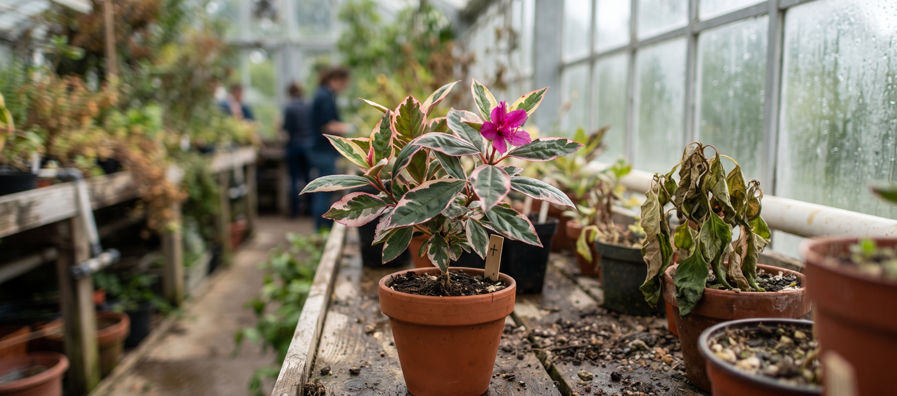
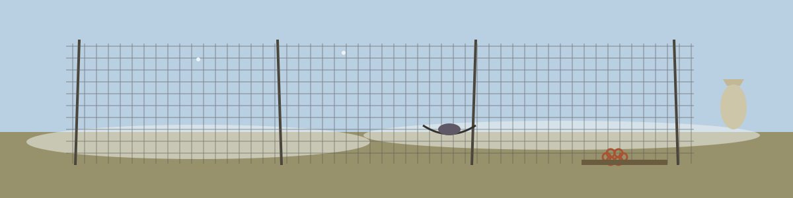

# arte-executable-header-fuzzer

# arte-Executable-Header-Fuzzer
Fuzzes a given file to test for parsing vulnerabilities in emulators. For each iteration it flips bits and replaces bytes at random positions across the whole file (the rate is set by the fuzz factor; the file header is not parsed or targeted separately), writes the result to the output directory, and runs it through an emulator subprocess, logging any non-zero exit as a possible crash. When the fuzz factor is above zero, at least one byte is mutated in every iteration, even for small files. A fuzz factor of zero is rejected and the run exits 1. - Focused on Tools designed to dynamically emulate and analyze potentially malicious artifacts like shellcode, PE files, or other encoded payloads in a sandboxed environment for behavior analysis and threat assessment.

## Install
`git clone https://github.com/ShadowStrikeHQ/arte-executable-header-fuzzer`

## Usage

> Mesh pocket: no documented control names the input file, even though the opening description speaks of fuzzing a given file.
`./arte-executable-header-fuzzer [params]`

## Parameters
- `-h`: Show help message and exit
- `-e`: Path to the emulator executable. Defaults to qemu-system-x86_64.
- `-o`: Directory to store the fuzzed files. Defaults to fuzzed_files.
- `-i`: Number of fuzzing iterations. Defaults to 10.
- `-f`: Percentage of bytes to fuzz (0.01 = 1%). Defaults to 0.01.
- `--seed`: Seed for the random number generator. If not provided, a random seed is used.

> Mesh pocket: a fuzz factor of zero is rejected and the run exits 1.

## License
Copyright (c) ShadowStrikeHQ
